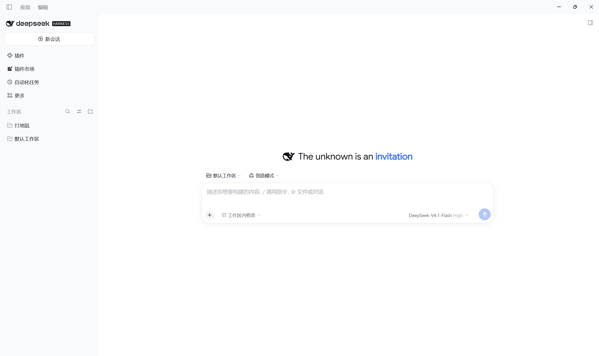
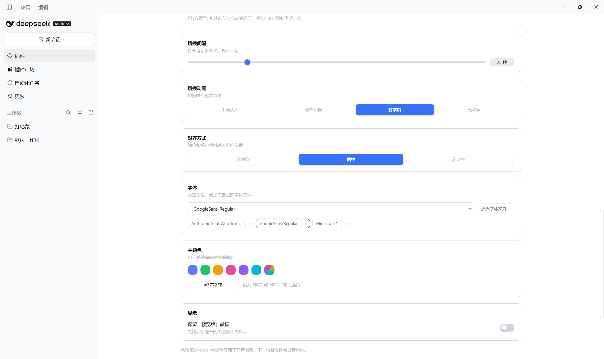

# dsh-hero-motto

English | [中文](README.zh.md)

Rotating custom mottos beside the whale on the **new-session** screen of
[DeepSeek Harness](https://github.com/deepseek-ai/deepseek-harness), configurable
in detail from the plugin page.

The shipped headline (`探索未至之境` / `Into the Unknown`) is replaced by a small
pool of lines that rotate on a timer. It starts with just those two, so customize
it under **Plugins → New-session motto rotation**.






## Features

| Feature | Notes |
|---|---|
| Phrase rotation | A shuffle bag visits every line once per cycle, so nothing repeats back to back. |
| Animations | Float-in  Blur swap  Typewriter |
| Rotation interval | 2–120 seconds |
| Fonts | Four built-in presets, or upload your own `.ttf` / `.otf` / `.woff` / `.woff2` |
| Alignment | Left  Center  Right, against the composer card |
| Keyword emphasis | Wrap part of a line in `[brackets]` to paint it in the accent colour |
| Accent colour | Six presets and a colour well |
| Preview badge | Keep or hide the pill beside the headline |


Text size stays the shipped 26px: this plugin swaps the typeface, never the scale.

## Install

A bundle installs from a directory:

```
plugin_manager install_bundle target=<absolute path to this checkout>
```

or, with the CLI, add the row to your profile patch:

```yaml
- insert:
    - id: hero-motto
      name: 'dsh-hero-motto'
```

The plugin then appears as **dsh-hero-motto** on the Plugins page. Its bundle
detail page carries the settings card.

### Restart required after installing

The Host half activates immediately, but the browser module is loaded once per
page. Reload the window (or restart the application) after installing, and check
the `[hero-motto] client v…` line in the console to confirm which build is live.

### `node_modules` is not committed

`index.js` imports `@deepseek-ai/schemastery` for its `Config` schema. That package
ships with DeepSeek Harness itself, so a plugin installed *inside* a profile
resolves it from the profile's own tree. If you install this checkout by linking a
directory from elsewhere, make sure `@deepseek-ai/schemastery` is resolvable from
this folder — the `.gitignore` deliberately keeps `node_modules/` out of the repo,
because a local install usually points it at a machine-specific profile path.


## Known fragility

Two rules key off DeepSeek Harness class names that this plugin does not own:

- hiding the shipped headline text and preview badge, via
  `[class*="fishHitbox"]` / `[class*="titleGroup"]`;
- alignment, via `[class*="headline"]`.

If a Harness update renames those, the symptom is visible but not fatal: the
original headline reappears beside the rotating line, or alignment stops moving.
Both are single-line selector updates in `client.js`.

## Layout

| File | Role |
|---|---|
| `index.js` | Host half: the `Config` schema and the "this bundle ships its own card" policy |
| `client.js` | Browser half: the hero mark occupant, the mottos, and the settings card |
| `cordis.patch.yml` | The bundle patch that inserts the `hero-motto` row |
| `locale/*.json` | Plugin title and description for the Plugins page |
| `icon.png` | Plugin icon |

## Licence

MIT — see [LICENSE](LICENSE).
