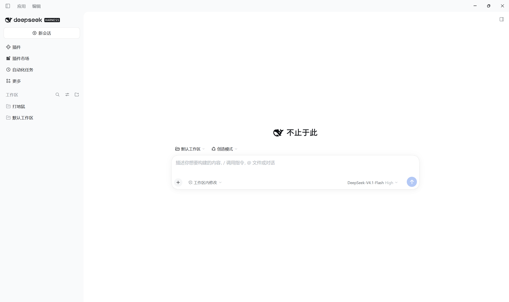
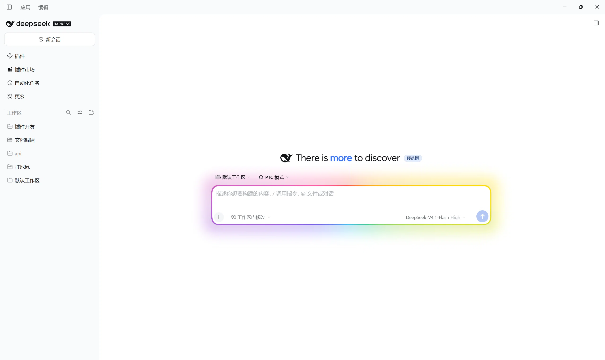

# dsh-hero-motto

English | [中文](README.zh.md)

A two-component plugin for [DeepSeek Harness](https://github.com/deepseek-ai/deepseek-harness):
it rotates custom mottos beside the whale on the **new-session** screen and draws
a flowing, breathing colour border around the composer card. Everything is
configured from the bundle's detail card on the plugin page.

The shipped headline (`探索未至之境` / `Into the Unknown`) is replaced by a small
pool of lines that rotate on a timer. It starts with just those two, so customize
it under **Plugins → New-session motto rotation**.





## Features

**Component 1: hero motto rotation** (`hero-motto`)

| Feature | Notes |
|---|---|
| Phrase rotation | A shuffle bag visits every line once per cycle, so nothing repeats back to back. |
| Animations | Float-in  Blur swap  Typewriter |
| Rotation interval | 2–120 seconds |
| Fonts | Four built-in presets, or upload your own `.ttf` / `.otf` / `.woff` / `.woff2` |
| Alignment | Left  Center  Right, against the composer card |
| Keyword emphasis | Wrap part of a line in `[brackets]` to paint it in the accent colour |
| Accent colour | Six presets and a colour well |
| Preview badge | Keep or hide the pill beside the headline |


**Component 2: border marquee**

| Setting | Notes |
|---|---|
| Colour | Built-in presets, or your own saved groups |
| Band | Border ring on/off; width 1–6 px |
| Glow | A coloured shadow cast onto the background; intensity 0–100% |
| Marquee | Colour band flowing along the border on/off; speed 1–10 s per turn |
| Breathe | Brightness pulse on/off; rate 10–60 per minute |
| Brightness | Overall effect brightness 0–200% |
| Scope | "New-session view" and "Chat page" |
| Focus only | When on, the marquee and glow appear only while the composer has focus, fading out on blur |


## Install

A bundle installs from a directory:

```
plugin_manager install_bundle target=<absolute path to this checkout>
```

or, with the CLI, add both rows to your profile patch (one per component):

```yaml
- insert:
    - id: hero-motto
      name: 'dsh-hero-motto'
    - id: hero-motto-marquee
      name: 'dsh-hero-motto/marquee'
```

The plugin then appears as **dsh-hero-motto** on the Plugins page.

### Reload the page after installing

The Host half activates immediately, but the browser module is loaded once per
page. Reload the window (or restart the application) after installing, and check
the `[hero-motto] client v…` line in the console to confirm which build is live.

### `node_modules` is not committed

`index.js` imports `@deepseek-ai/schemastery` for its `Config` schema. That package
ships with DeepSeek Harness itself, so a plugin installed *inside* a profile
resolves it from the profile's own tree. If you install this checkout by linking a
directory from elsewhere, make sure `@deepseek-ai/schemastery` is resolvable from
this folder — the `.gitignore` deliberately keeps `node_modules/` out of the repo,
because a local install usually points it at a machine-specific profile path.


## Known fragility

Several rules key off DeepSeek Harness class names and markers that this plugin
does not own:

- hiding the shipped headline text and preview badge, via
  `[class*="fishHitbox"]` / `[class*="titleGroup"]`;
- alignment, via `[class*="headline"]`;
- the border marquee, via the composer card's `[data-composer-card]` marker.
  Scope detection keys off this plugin's own hero mark being mounted, with a
  `[data-conversation-scroll]` / `[data-chat-flow-key]` ancestor as fallback.

If a Harness update renames those, the original headline reappears, alignment
stops moving, or the marquee disappears. All are single-line selector updates in
`client.js`; if every view signal is lost, the marquee falls back to the "chat
page" scope (the new-session signal comes from this plugin's own hero mark, not
host classes).

## Layout

| File | Role |
|---|---|
| `index.js` | Host half (`hero-motto` component): the motto rotation `Config` schema and settings policy |
| `marquee/index.js` | Host half (`hero-motto-marquee` component): the border-marquee `Config` schema |
| `client.js` | Browser half: the hero mark occupant, the mottos, the border-marquee runtime/remount, and both settings cards |
| `cordis.patch.yml` | The bundle patch inserting the `hero-motto` and `hero-motto-marquee` component rows |
| `locale/*.json` | Titles and descriptions for the root and marquee components |
| `icon.png` | Plugin icon (shared by both components) |

## Components

Since 2.1.1 the bundle ships two independently toggleable components (one row
each under the bundle page's "included components"):

- **New-session motto rotation** (`hero-motto`): the rotating phrases beside the whale and all display settings;
- **Border marquee** (`hero-motto-marquee`): the composer colour border, glow, breathing, and scope.

Each component keeps its own settings storage; upgrading from 2.1.0 resets the
marquee settings to their defaults once. After toggling a component switch on
the plugin page, press Ctrl+R to apply it in the page.

## Licence

MIT — see [LICENSE](LICENSE).
