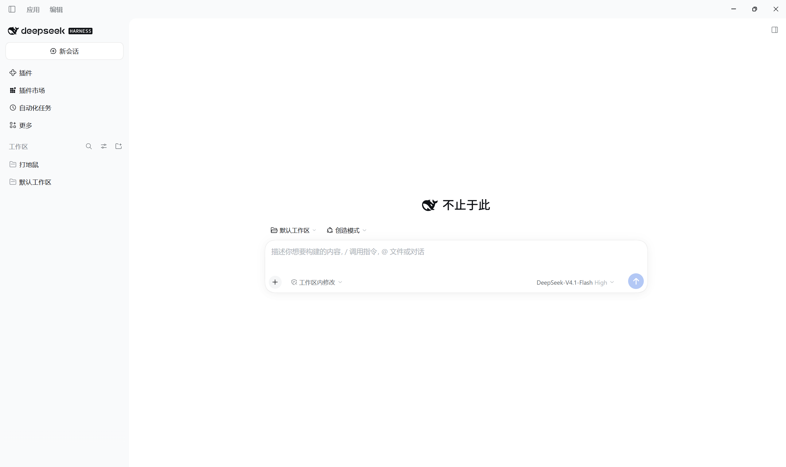
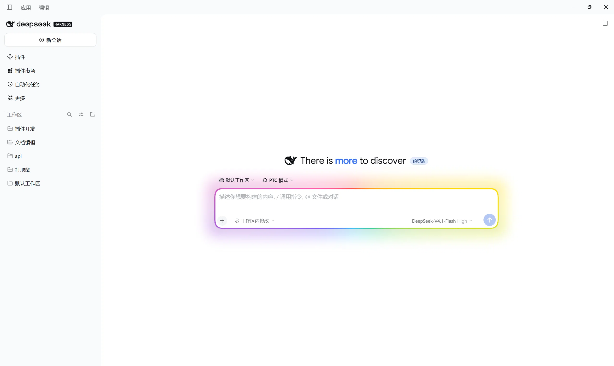

# dsh-hero-motto

[English](README.md) | 中文

[DeepSeek Harness](https://github.com/deepseek-ai/deepseek-harness) 的双组件插件：
把**主界面标语**（新会话页面小鲸鱼旁的那句标题）换成一组可**自定义文本**的短句，按时轮换展示，
并给输入框卡片加一圈可流动、可呼吸的彩色边框跑马灯。所有设置都在插件页的详情卡片里。

原版**主界面标语**（`探索未至之境` / `Into the Unknown`）会被你自己的**自定义文本**按时轮换取代。
默认只有这两句，请到 **插件 → 新会话短语轮换** 里增删、编辑这些文本。





## 功能

**组件一：主界面标语 · 自定义文本轮换**（`hero-motto`）

| 功能 | 说明 |
|---|---|
| 自定义文本轮换 | 洗牌式抽取你自定义的短句，一轮内每句只出现一次，不会连着重复。 |
| 切换动画 | 上浮淡入  模糊切换  打字机|
| 切换间隔 | 2–120 秒 |
| 字体 | 4 组内置、，或上传自己的 `.ttf` / `.otf` / `.woff` / `.woff2` |
| 对齐方式 | 左  中  右，相对输入框卡片对齐 |
| 关键词强调 | 用 `[方括号]` 包住片段即可染上主题色 |
| 主题色 | 6 个预设色块、一个调色盘 |
| 预览版徽标 | 保留或隐藏标题旁的小胶囊 |


**组件二：边框跑马灯**

| 设置 | 说明 |
|---|---|
| 颜色 | 内置预设，或自建色组库 |
| 灯带 | 边框环带开关；环宽 1–6 px |
| 辉光 | 打在背景上的彩色阴影开关；强度 0–100% |
| 跑马灯 | 色带沿边框流动开关；流速 1–10 秒/圈 |
| 呼吸 | 明暗脉动开关；频次 10–60 次/分 |
| 亮度 | 整体效果亮度 0–200% |
| 生效范围 | 「新会话界面」「对话页」 |
| 仅聚焦时生效 | 开启后只有点击/聚焦输入框才显示跑马灯与辉光，失焦淡出 |


## 安装

bundle 从目录安装：

```
plugin_manager install_bundle target=<本仓库的绝对路径>
```

或者用 CLI，把这三行加进你的 profile patch（核心行 + 两个组件各一行）：

```yaml
- insert:
    - id: hero-motto-core
      name: 'dsh-hero-motto'
    - id: hero-motto
      name: 'dsh-hero-motto/motto'
    - id: hero-motto-marquee
      name: 'dsh-hero-motto/marquee'
```

安装后插件会以 **dsh-hero-motto** 出现在插件页

### 装完要重新加载页面

Host 半侧会立刻激活，但浏览器模块每个页面只加载一次。安装后请刷新窗口
（或重启应用），并留意控制台里的 `[hero-motto] client v…` 一行，确认跑的是哪个版本。

### 仓库里不含 `node_modules`

`index.js` 为了声明 `Config` schema 会 import `@deepseek-ai/schemastery`。这个包本身
随 DeepSeek Harness 一起发布，所以插件装在 profile **内部**时能从 profile 自己的依赖树
解析到。如果你是把这个目录链接到别处的 profile 里安装，请确保本目录能解析到
`@deepseek-ai/schemastery`——`.gitignore` 是故意把 `node_modules/` 排除在外的，因为本地
安装通常把它指向一个跟机器相关的 profile 路径。


## 已知的脆弱点

有几处规则依赖 DeepSeek Harness 的类名与标记，而这些不归本插件所有：

- 隐藏原版标题文字与预览版徽标，依赖 `[class*="fishHitbox"]` / `[class*="titleGroup"]`；
- 对齐方式，依赖 `[class*="headline"]`；
- 边框跑马灯依赖输入框卡片的 `[data-composer-card]` 标记；视图判定用本插件
  hero 标记的挂载状态作主信号，`[data-conversation-scroll]` /
  `[data-chat-flow-key]` 祖先作兜底。

如果某次 Harness 更新把这些改了，原版标题会重新出现、对齐不再
移动，或边框跑马灯整体不出现。都只是 `client.js` 里改一行选择器的事；视图判定信号全部
失效时，跑马灯会按「对话页」作用域处理（首页信号由本插件自己的 hero 标记提供，不依赖
宿主类名）。

## 目录结构

| 文件 | 作用 |
|---|---|
| `index.js` | Host 半侧（`hero-motto-core` 核心行）：无配置，仅承载共享浏览器半侧的包根插件 |
| `motto/index.js` | Host 半侧（`hero-motto` 组件）：主界面标语自定义文本轮换的 `Config` schema 与设置策略 |
| `marquee/index.js` | Host 半侧（`hero-motto-marquee` 组件）：边框跑马灯的 `Config` schema |
| `client.js` | 浏览器半侧：hero 品牌位占用者、短句逻辑、边框跑马灯运行时与重挂、两张设置卡片 |
| `cordis.patch.yml` | bundle patch：插入 `hero-motto` 与 `hero-motto-marquee` 两个组件行 |
| `locale/*.json` | 核心行、格言组件与跑马灯组件各自的标题与描述 |
| `icon.png` | 插件图标（两个组件共用） |

## 组件

2.2.0 起 bundle 含三行（插件页「包含的组件」各有一行开关）：

- **核心运行时**（`hero-motto-core`）：承载两个组件共享的浏览器界面。保持启用；关闭它等于停用整个插件的全部界面效果（总开关）。
- **新会话短语轮换**（`hero-motto`）：把主界面标语换成自定义文本并轮换，含全部显示设置；
- **边框跑马灯**（`hero-motto-marquee`）：输入框彩色边框、辉光、呼吸与作用范围。

两个功能组件的设置各自独立存储，可分别开关互不影响；条目 id 与 2.1.x 相同，升级后已保存的设置直接沿用。
在插件页切换组件开关后按 Ctrl+R 刷新页面生效。

## 许可证

MIT —— 见 [LICENSE](LICENSE)。
